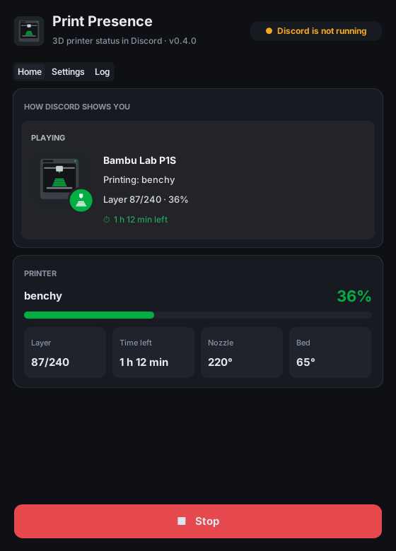
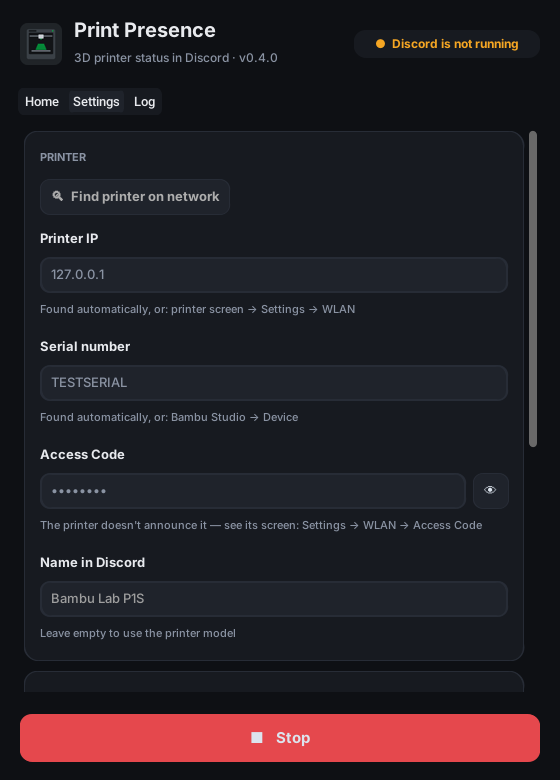

# Print Presence

**English** · [Русский](README.ru.md)

Discord Rich Presence for 3D printers: your friends see what you're printing, the current layer, progress and time left.

<p>
  
  
</p>

Supports **Bambu Lab** printers (tested on P1S) over the local network. Other printers can be added as separate modules in `print_presence/printers/`.

> Unofficial project, not affiliated with Bambu Lab or Discord.

## Features

- Status in Discord: printing / preparing / paused / finished / failed / idle, file name, layer `87/240`, percent, countdown to the end, nozzle and bed temperatures on hover
- **Finds the printer on the network automatically**: IP, serial number and model — you only type the Access Code
- Printer picture in Discord matches your model (X1, P1S, P1P, A1, A1 mini, H2D)
- Live preview of how Discord shows you, progress bar, temperatures
- Nothing to set up in Discord — the shared app with icons is built in
- Works locally: talks to the printer over your LAN, no Bambu cloud, the Access Code never leaves your PC
- English and Russian interface, picked from your system language

## Requirements

- Windows 10/11
- The Discord **desktop app** (Rich Presence doesn't work in the browser) running on the same PC
- The printer and the PC on the same local network

## Install

1. Download `PrintPresence.exe` from [Releases](../../releases/latest) (or build it yourself, see below).
2. Run it. Windows may say "Windows protected your PC" because the app isn't code-signed: click **More info → Run anyway**.
3. On first launch the app looks for printers on your network and fills in the **IP, serial number and model**. If Windows asks about the firewall, allow access on private networks — otherwise discovery can't work.
4. Enter the **Access Code** (the printer doesn't announce it: printer screen → Settings → WLAN) and press **▶ Start**.

If discovery doesn't find the printer (different subnet, VPN, blocked by the firewall), enter the IP and serial number by hand.

Settings are saved to `%APPDATA%\PrintPresence\settings.json`.
"Start automatically when the app opens" starts the status without pressing the button.
Leave "Name in Discord" empty to show the printer model, e.g. `Bambu Lab P1S`.

## Own Discord application (optional)

By default the app uses the shared Print Presence application — icons are already uploaded, nothing to do.
You only need your own app for your own icons or your own name after "Playing".

1. Open <https://discord.com/developers/applications> → **New Application**.
2. The application name is what shows after "Playing", e.g. `Bambu Lab P1S`.
3. On **General Information** copy the **Application ID**.
4. **Rich Presence → Art Assets**: upload images (at least 512×512, you can start from [`assets/`](assets)). The asset name is the file name without `.png`:

   | Asset name | What it is |
   |---|---|
   | `printer` | large image — the printer |
   | `printing` | "printing" badge |
   | `paused` | "paused" badge |
   | `finished` | "finished" badge |
   | `failed` | "failed" badge |
   | `idle` | "idle" badge |

   Discord sometimes takes 5–10 minutes to show newly uploaded images.
5. In the app, turn off **Standard design** and paste the Application ID into **Own Application ID**.

## Troubleshooting

- **"Printer refused the connection" / "Not authorized"**: check the IP and Access Code (it changes if you refresh it on the printer).
- If they're definitely correct and the printer still refuses (newer Bambu firmware restricts third-party access): enable **LAN Only Mode** and then **Developer Mode** on the printer. Note that LAN Only disables the cloud and Bambu Handy.
- **Discovery finds nothing**: allow the app in Windows Firewall (private networks). Bambu Studio may hold the same ports — close it while searching, or enter the IP by hand.
- **"Discord is not running"**: start the Discord desktop app, Print Presence reconnects by itself.
- Details are in the **Log** tab.

## Build from source

Requires Python 3.11+.

```bash
python -m venv .venv
.venv\Scripts\activate          # Windows
pip install -r requirements.txt pytest
python -m pytest
python run_gui.py               # desktop app
python -m print_presence -v     # console version, reads config.toml (see config.example.toml)
```

Build the exe: run `build.bat` — it installs everything and puts the app into `dist\PrintPresence.exe`.
The **Build Windows exe** workflow in the Actions tab does the same on GitHub and publishes a release for the current version.

Adding another printer: create a `Printer` subclass in `print_presence/printers/` that returns `PrinterStatus`, and register it in `printers/__init__.py`.

## License

[MIT](LICENSE). Bambu Lab is a trademark of its owner; this project is not endorsed by Bambu Lab.
