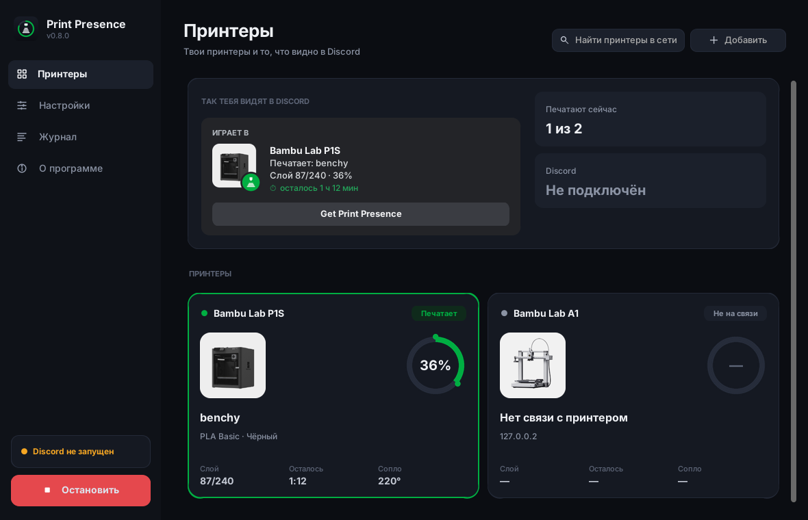
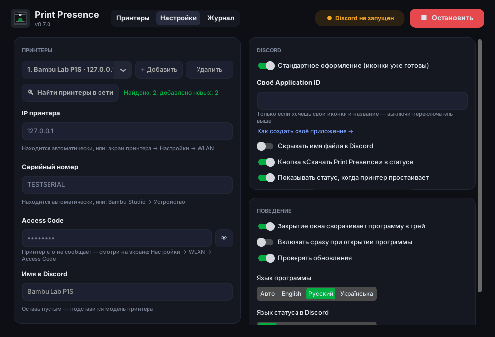

<p align="center"></p>

<h1 align="center">Print Presence</h1>

[English](README.md) · **Русский** · [Українська](README.uk.md)

Discord Rich Presence для 3D-принтеров: друзья в Discord видят, что ты печатаешь, на каком слое, сколько процентов готово и сколько осталось.

<p align="center"><b><a href="https://github.com/B0D1KG0/print-presence/releases/latest/download/PrintPresence-Setup.exe">⬇ Скачать установщик</a></b> · <a href="https://github.com/B0D1KG0/print-presence/releases/latest/download/PrintPresence-Portable.zip">Портативная версия (zip)</a> · <a href="https://github.com/B0D1KG0/print-presence/releases">Все версии</a></p>

<p>
  <br>
  
</p>

Поддерживаются принтеры **Bambu Lab** (проверяется на P1S) через локальную сеть. Другие принтеры можно добавить отдельным модулем в `print_presence/printers/`.

> Неофициальный проект, не связан с Bambu Lab или Discord.

## Возможности

- Статус в Discord: печатает / готовится / пауза / готово / ошибка / простаивает, имя файла, слой `87/240`, проценты, обратный отсчёт до конца; филамент (`PLA Basic · Чёрный`) и температуры при наведении
- **Сам находит принтеры в сети**: IP, серийный номер и модель — вводишь только Access Code
- **Несколько принтеров** (ферма): в Discord показывается тот, что сейчас печатает
- Картинка принтера в Discord под твою модель (X1, P1S, P1P, A1, A1 mini, H2D)
- Панель с карточкой на каждый принтер: фото, кольцо прогресса, слой, оставшееся время, филамент
- **Работает в трее** и может **запускаться вместе с Windows**; сообщает о новой версии
- Приватность: по желанию скрывает имя файла
- В Discord ничего настраивать не нужно — общее приложение с иконками уже встроено
- Работает локально: общается с принтером по локальной сети, без облака Bambu, Access Code не покидает твой ПК
- Интерфейс на русском, украинском и английском, выбирается по языку системы

## Что нужно

- Windows 10/11
- Discord **десктоп-приложение** (в браузере Rich Presence не работает), запущенное на том же ПК
- Принтер и ПК в одной локальной сети

## Установка

1. Скачай один из вариантов (всегда последняя версия):

   | Файл | Для кого |
   |---|---|
   | **[PrintPresence-Setup.exe](https://github.com/B0D1KG0/print-presence/releases/latest/download/PrintPresence-Setup.exe)** | Для большинства. Устанавливает программу с ярлыками в «Пуске» и на рабочем столе, удаляется через «Установка и удаление программ». Права администратора не нужны. |
   | **[PrintPresence-Portable.zip](https://github.com/B0D1KG0/print-presence/releases/latest/download/PrintPresence-Portable.zip)** | Распакуй куда угодно (хоть на флешку) и запусти. Настройки хранятся в папке `data` рядом с программой, в систему ничего не пишется. |
   | [PrintPresence.exe](https://github.com/B0D1KG0/print-presence/releases/latest/download/PrintPresence.exe) | Один файл без установки; настройки в `%APPDATA%\PrintPresence`. |

2. Запусти. Windows может показать «Windows защитила ваш компьютер» — это потому, что программа не подписана сертификатом: нажми **Подробнее → Выполнить в любом случае**.
3. При первом запуске программа сама ищет принтер в сети и подставляет **IP, серийный номер и модель**. Если Windows спросит про брандмауэр — разреши доступ для частных сетей, иначе поиск не сработает.
4. Введи **Access Code** (принтер его не сообщает: экран принтера → Настройки → WLAN) и нажми **▶ Запустить**.

Если автопоиск не нашёл принтер (другая подсеть, VPN, закрыт брандмауэр) — IP и серийный номер можно ввести вручную.

Настройки сохраняются в `%APPDATA%\PrintPresence\settings.json` (портативная версия — в папке `data` рядом с программой).

- **Несколько принтеров**: Настройки → Принтеры → **+ Добавить**, или **Найти принтеры в сети** — добавит все найденные. В Discord показывается самый занятый (печатает > пауза > готовится > готово > простаивает).
- **Трей**: закрытие окна оставляет программу работать возле часов; правый клик по значку — Открыть / Запустить / Остановить / Выход.
- **Запуск вместе с Windows**: программа стартует свёрнутой в трей и сама включает статус.
- «Имя в Discord» видно при наведении на картинку в статусе; если оставить пустым — подставится модель принтера. Название после «Играет в» — всегда имя Discord-приложения.
- Кнопку **«Get Print Presence»** в статусе видят только другие люди (свои кнопки Discord тебе не показывает). Её можно выключить.

## Своё Discord-приложение (необязательно)

По умолчанию программа использует общее приложение Print Presence — иконки уже загружены, ничего делать не нужно.
Своё приложение нужно, только если хочешь свои иконки или своё название после «Играет в».

1. Открой <https://discord.com/developers/applications> → **New Application**.
2. Имя приложения — это то, что видно после «Играет в», например `Bambu Lab P1S`.
3. На странице **General Information** скопируй **Application ID**.
4. **Rich Presence → Art Assets** — загрузи картинки (от 512×512, можно взять из папки [`assets/`](assets) и поменять). Имя ассета = имя файла без `.png`:

   | Имя ассета | Что это |
   |---|---|
   | `printer` | большая картинка — принтер |
   | `printing` | значок «печатает» |
   | `paused` | значок «пауза» |
   | `finished` | значок «готово» |
   | `failed` | значок «ошибка» |
   | `idle` | значок «простой» |

   После загрузки Discord иногда показывает картинки только через 5–10 минут.
5. В программе выключи **«Стандартное оформление»** и вставь Application ID в поле **«Своё Application ID»**.

## Если не работает

- **«Принтер отклонил подключение» / «Not authorized»** — проверь IP и Access Code (он меняется, если обновить его на принтере).
- Если данные точно верные, а принтер всё равно не пускает (новые прошивки Bambu ограничивают сторонний доступ): на принтере включи **LAN Only Mode**, а затем **Developer Mode**. Учти, что в LAN Only не работает облако и Bambu Handy.
- **Автопоиск ничего не нашёл** — разреши программу в брандмауэре Windows (частные сети). Bambu Studio может занимать те же порты — закрой его на время поиска или введи IP вручную.
- **«Discord не запущен»** — запусти Discord-приложение, программа переподключится сама.
- Подробности — во вкладке **«Журнал»**.

## Сборка из исходников

Нужен Python 3.11+.

```bash
python -m venv .venv
.venv\Scripts\activate          # Windows
pip install -r requirements.txt pytest
python -m pytest
python run_gui.py               # программа с окном
python -m print_presence -v     # консольная версия, читает config.toml (см. config.example.toml)
```

Сборка: запусти `build.bat` — он установит всё нужное и создаст `dist\PrintPresence.exe`, `dist\PrintPresence-Portable.zip`, а если установлен [Inno Setup 6](https://jrsoftware.org/isinfo.php) (`winget install JRSoftware.InnoSetup`) — ещё и `dist\PrintPresence-Setup.exe`.
Чтобы подписать файл, перед запуском `build.bat` задай `SIGN_CERT` (путь к `.pfx`) и `SIGN_PASSWORD` (нужен `signtool` из Windows SDK).
Workflow **Build Windows exe** во вкладке Actions делает то же самое на GitHub и публикует релиз текущей версии.

Добавить новый принтер: создай класс-наследник `Printer` в `print_presence/printers/`, который возвращает `PrinterStatus`, и зарегистрируй его в `printers/__init__.py`.

## Лицензия

[MIT](LICENSE) © B0D1KG0. Сторонние компоненты: [THIRD-PARTY-NOTICES.md](THIRD-PARTY-NOTICES.md). Bambu Lab — товарный знак его владельца; проект не одобрен Bambu Lab.
