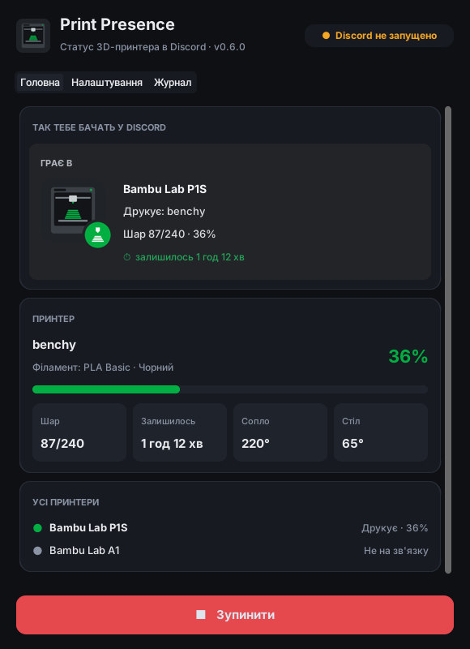
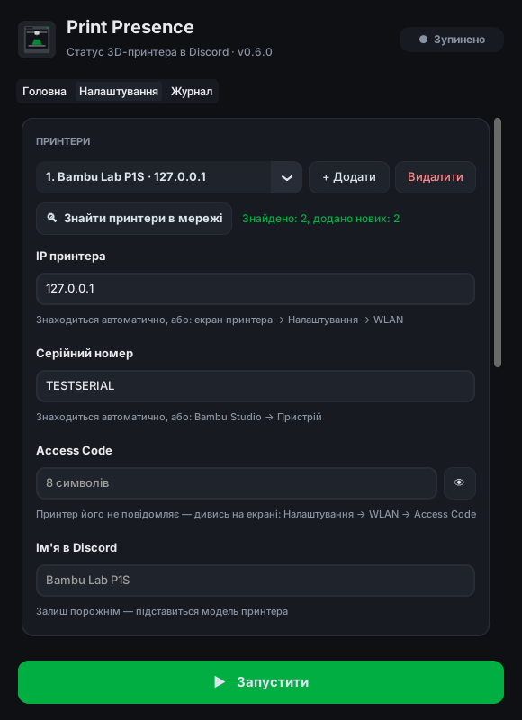

# Print Presence

[English](README.md) · [Русский](README.ru.md) · **Українська**

Discord Rich Presence для 3D-принтерів: друзі в Discord бачать, що ти друкуєш, на якому шарі, скільки відсотків готово і скільки залишилось.

**[⬇ Завантажити PrintPresence.exe](https://github.com/B0D1KG0/print-presence/releases/latest/download/PrintPresence.exe)** · [Усі версії](https://github.com/B0D1KG0/print-presence/releases)

<p>
  
  
</p>

Підтримуються принтери **Bambu Lab** (перевіряється на P1S) через локальну мережу. Інші принтери можна додати окремим модулем у `print_presence/printers/`.

> Неофіційний проєкт, не пов'язаний з Bambu Lab чи Discord.

## Можливості

- Статус у Discord: друкує / готується / пауза / готово / помилка / простоює, назва файлу, шар `87/240`, відсотки, зворотний відлік до кінця; філамент (`PLA Basic · Чорний`) і температури при наведенні
- **Сам знаходить принтери в мережі**: IP, серійний номер і модель — вводиш лише Access Code
- **Кілька принтерів** (ферма): у Discord показується той, що зараз друкує
- Картинка принтера в Discord під твою модель (X1, P1S, P1P, A1, A1 mini, H2D)
- **Працює в треї** і може **запускатися разом з Windows**; повідомляє про нову версію
- Приватність: за бажанням приховує назву файлу
- У Discord нічого налаштовувати не треба — спільний застосунок з іконками вже вбудований
- Працює локально: спілкується з принтером через локальну мережу, без хмари Bambu, Access Code не залишає твій ПК
- Інтерфейс українською, англійською та російською, вибирається за мовою системи

## Що потрібно

- Windows 10/11
- Discord **десктоп-застосунок** (у браузері Rich Presence не працює), запущений на тому ж ПК
- Принтер і ПК в одній локальній мережі

## Встановлення

1. Завантаж **[PrintPresence.exe](https://github.com/B0D1KG0/print-presence/releases/latest/download/PrintPresence.exe)** — завжди остання версія (або збери сам, див. нижче).
2. Запусти. Windows може показати «Windows захистила ваш комп'ютер» — це тому, що програма не підписана сертифікатом: натисни **Докладніше → Усе одно запустити**.
3. При першому запуску програма сама шукає принтери в мережі й підставляє **IP, серійний номер і модель**. Якщо Windows запитає про брандмауер — дозволь доступ для приватних мереж, інакше пошук не спрацює.
4. Введи **Access Code** (принтер його не повідомляє: екран принтера → Налаштування → WLAN) і натисни **▶ Запустити**.

Якщо автопошук не знайшов принтер (інша підмережа, VPN, закритий брандмауер) — IP і серійний номер можна ввести вручну.

Налаштування зберігаються в `%APPDATA%\PrintPresence\settings.json`.

- **Кілька принтерів**: Налаштування → Принтери → **+ Додати**, або **Знайти принтери в мережі** — додасть усі знайдені. У Discord показується найзайнятіший (друкує > пауза > готується > готово > простоює).
- **Трей**: закриття вікна залишає програму працювати біля годинника; правий клік по значку — Відкрити / Запустити / Зупинити / Вихід.
- **Запуск разом з Windows**: програма стартує згорнутою в трей і сама вмикає статус.
- Поле «Ім'я в Discord» можна залишити порожнім — підставиться модель принтера, наприклад `Bambu Lab P1S`.
- Кнопку **«Завантажити Print Presence»** у статусі бачать лише інші люди (свої кнопки Discord тобі не показує). Її можна вимкнути.

## Власний Discord-застосунок (необов'язково)

За замовчуванням програма використовує спільний застосунок Print Presence — іконки вже завантажені, нічого робити не треба.
Власний застосунок потрібен, лише якщо хочеш свої іконки або свою назву після «Грає в».

1. Відкрий <https://discord.com/developers/applications> → **New Application**.
2. Назва застосунку — це те, що видно після «Грає в», наприклад `Bambu Lab P1S`.
3. На сторінці **General Information** скопіюй **Application ID**.
4. **Rich Presence → Art Assets** — завантаж картинки (від 512×512, можна взяти з папки [`assets/`](assets) і змінити). Назва ассета = назва файлу без `.png`:

   | Назва ассета | Що це |
   |---|---|
   | `printer` | велика картинка — принтер |
   | `printing` | значок «друкує» |
   | `paused` | значок «пауза» |
   | `finished` | значок «готово» |
   | `failed` | значок «помилка» |
   | `idle` | значок «простій» |

   Після завантаження Discord іноді показує картинки лише через 5–10 хвилин.
5. У програмі вимкни **«Стандартне оформлення»** і встав Application ID у поле **«Власний Application ID»**.

## Якщо не працює

- **«Принтер відхилив підключення» / «Not authorized»** — перевір IP і Access Code (він змінюється, якщо оновити його на принтері).
- Якщо дані точно правильні, а принтер усе одно не пускає (нові прошивки Bambu обмежують сторонній доступ): на принтері увімкни **LAN Only Mode**, а потім **Developer Mode**. Зверни увагу, що в LAN Only не працює хмара і Bambu Handy.
- **Автопошук нічого не знайшов** — дозволь програму в брандмауері Windows (приватні мережі). Bambu Studio може займати ті самі порти — закрий його на час пошуку або введи IP вручну.
- **«Discord не запущено»** — запусти Discord-застосунок, програма перепідключиться сама.
- Подробиці — у вкладці **«Журнал»**.

## Збирання з вихідного коду

Потрібен Python 3.11+.

```bash
python -m venv .venv
.venv\Scripts\activate          # Windows
pip install -r requirements.txt pytest
python -m pytest
python run_gui.py               # програма з вікном
python -m print_presence -v     # консольна версія, читає config.toml (див. config.example.toml)
```

Зібрати `.exe`: запусти `build.bat` — він встановить усе потрібне й покладе програму в `dist\PrintPresence.exe`.
Щоб підписати файл, перед запуском `build.bat` задай `SIGN_CERT` (шлях до `.pfx`) і `SIGN_PASSWORD` (потрібен `signtool` з Windows SDK).
Workflow **Build Windows exe** у вкладці Actions робить те саме на GitHub і публікує реліз поточної версії.

Додати новий принтер: створи клас-нащадок `Printer` у `print_presence/printers/`, який повертає `PrinterStatus`, і зареєструй його в `printers/__init__.py`.

## Ліцензія

[MIT](LICENSE). Bambu Lab — торговельна марка її власника; проєкт не схвалений Bambu Lab.
